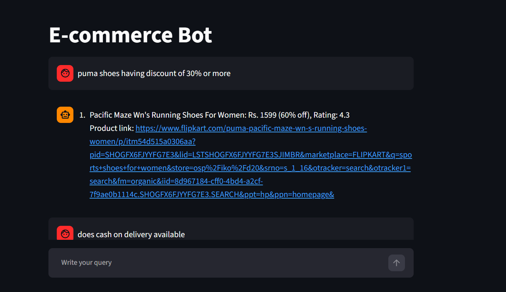
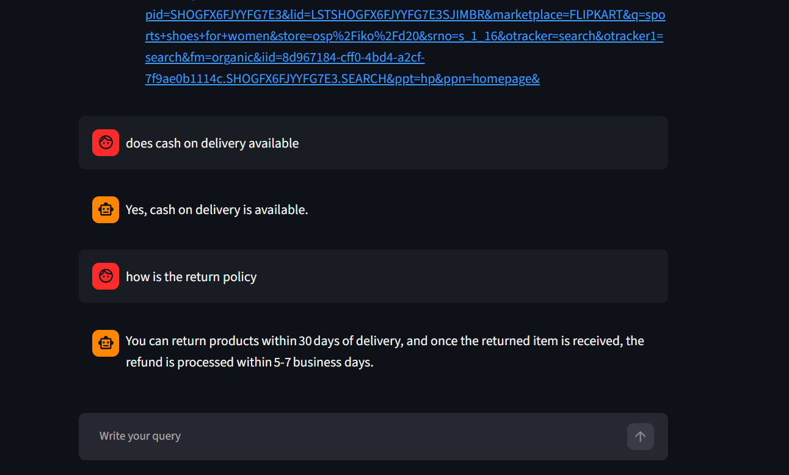

# E-Commerce Chatbot

An AI-powered e-commerce assistant built with **Python and Streamlit**. It understands customer questions and routes them to the appropriate workflow: answering frequently asked questions or searching a product database using natural language.

The product database is built from a data pipeline that uses **Selenium-based web scraping** to collect product details from Flipkart, saves the extracted data to CSV, and imports it into SQLite.

## Demo

### Product search



### FAQ conversations



## Features

- **Conversational interface:** Chat with the assistant through a Streamlit UI.
- **Semantic question routing:** Classifies incoming questions and directs them to the FAQ or product-query workflow.
- **FAQ retrieval:** Uses FAQ data and ChromaDB to retrieve relevant information for policy questions.
- **Natural-language product search:** Converts product questions into SQL queries with a Groq-hosted language model.
- **Web-scraped product data:** Uses Selenium with Chrome to gather Flipkart product-page links and extract product attributes.
- **CSV data preparation:** Uses Pandas to clean and save product details, duplicate records, and unavailable-product links.
- **SQLite database creation:** Imports the product CSV into a SQLite `product` table for chatbot queries.
- **Readable responses:** Converts matching product records into a natural-language answer.
- **Configurable settings:** Loads the Groq model and database path from environment variables.

## Example questions

**Product queries**
- “Show Puma shoes with a discount of 30% or more.”
- “Show the top 3 shoes in descending order of rating.”
- “Are there Nike shoes under ₹3,000?”
- “What is the price and rating of this product?”

**FAQ queries**
- “Is cash on delivery available?”
- “How is the return policy?”
- “How long does a refund take?”
- “What payment methods are accepted?”

The responses depend on the contents of the supplied FAQ data and local product database.

## How it works

1. A user submits a question through the Streamlit chat interface.
2. The semantic router decides whether the question belongs to the **FAQ** or **product/SQL** workflow.
3. For an FAQ question, the FAQ chain retrieves relevant information from the FAQ collection in ChromaDB and prepares an answer.
4. For a product question, the Groq model generates a SQL query based on the product schema.
5. The application executes the query against the local SQLite database.
6. The matching records are passed to the answer-generation step, which produces a user-friendly response in the chat.

```text
                         User question
                               |
                               v
                     Streamlit chat UI
                               |
                               v
                        Semantic router
                         /           \
                        v             v
                   FAQ route      Product route
                        |             |
                        v             v
                 FAQ data +       Groq model
                  ChromaDB       generates SQL
                        |             |
                        |             v
                        |        SQLite database <--- CSV-to-SQLite import
                        |             ^                         ^
                        |             |                         |
                        |        Product records           Product CSV
                        |                                       ^
                        |                                       |
                        |                           Selenium web scraper
                        v             v
                   FAQ answer   Product records
                        \             /
                         v           v
                       Chat response
```

## Product data pipeline: Selenium to SQLite

The repository includes a Jupyter notebook and a Python script for preparing the product database.

### 1. Scrape product data from Flipkart

`data_pipeline/flipkart_data_extraction.ipynb` uses Selenium with Chrome to:

1. Open Flipkart and search for `sports shoes for women`.
2. Collect product listing links across pagination pages and remove duplicate links.
3. Visit individual product pages and extract fields such as product URL, title, brand, price, discount, average rating, and total ratings.
4. Save the results to `flipkart_product_data.csv` and also save duplicate and unavailable-product records to separate CSV files.

The notebook currently limits the product-detail extraction stage to the **first 10 links** for demonstration. Remove or change the `.head(10)` limit if you intentionally want to process more products, while keeping site rules and request volume in mind. Website markup can change, so CSS selectors may need maintenance.

### 2. Convert the CSV data into SQLite

`data_pipeline/csv_to_sqlite.py` reads `flipkart_product_data.csv`, creates `db.sqlite` if it does not exist, creates the `product` table if needed, and appends the CSV rows to that table.

Run this script from the directory containing `flipkart_product_data.csv`, or update `csv_path` and `db_path` in the script to use the correct paths:

```bash
python data_pipeline/csv_to_sqlite.py
```

The script expects these files in its current working directory by default:

- `flipkart_product_data.csv` — produced by the scraping notebook.
- `db.sqlite` — created or updated by the import script.

**Note:** The script uses `if_exists='append'`, so running it repeatedly can insert duplicate rows into the database. Clear the table or add deduplication logic before re-importing the same CSV.

### Data pipeline dependencies

Install the libraries used by the notebook/script in the same Python environment:

```bash
python -m pip install selenium beautifulsoup4 lxml pandas
```

Selenium uses `webdriver.Chrome()`, so a compatible Google Chrome installation is required. Modern Selenium versions can manage the driver automatically in many setups.

**Responsible use:** Use web scraping only in ways permitted by the website's terms and applicable law. Respect robots guidance, access restrictions, rate limits, and personal-data requirements. This notebook is an educational example; page selectors and availability can change over time.

## Tech stack

| Technology | Role in the project |
|---|---|
| Python | Application logic and data pipeline |
| Streamlit | Interactive chat interface |
| Groq API | Language-model calls for SQL generation and response generation |
| Semantic Router | Routes user questions to the appropriate workflow |
| Hugging Face / Sentence Transformers | Text embeddings used by the semantic-routing or retrieval components |
| ChromaDB | Vector storage and retrieval for FAQs |
| SQLite | Stores structured product data |
| Pandas | Handles scraped product data, CSV files, and SQL query results |
| Selenium | Automates the browser to collect product links and product details |
| Beautiful Soup / lxml | Included in the scraping notebook's imports for HTML parsing support |
| `python-dotenv` | Loads local configuration from `.env` |

## Project structure

```text
ecommerce-chatbot/
├── app/
│   ├── main.py
│   ├── router.py
│   ├── faq.py
│   ├── sql.py
│   ├── .env                         # Local secrets; do not commit
│   ├── db.sqlite                    # Local product database, if included locally
│   └── resources/
│       └── faq_data.csv
├── data_pipeline/
│   ├── flipkart_data_extraction.ipynb # Selenium scraping notebook
│   └── csv_to_sqlite.py               # CSV-to-SQLite import script
├── assets/
│   ├── chatbot-demo-1.png
│   └── chatbot-demo-2.png
├── requirements.txt
└── README.md
```

Generated files such as `flipkart_product_data.csv`, `flipkart_product_links.csv`, `unavailable_products.csv`, `duplicate_products.csv`, and `db.sqlite` are produced by running the data pipeline. Keep the generated files in the locations expected by your scripts and application.

## Getting started

### Prerequisites

- Python installed
- A Groq API key
- Internet access for Groq API calls and first-time model downloads
- The project files and data used by the application

### 1. Clone the repository

```bash
git clone https://github.com/ShibilyThottoli/ecommerce-chatbot.git
cd ecommerce-chatbot
```

### 2. Create and activate a virtual environment

**Windows PowerShell**

```powershell
python -m venv .venv
.\.venv\Scripts\Activate.ps1
```

### 3. Install dependencies

```bash
python -m pip install -r requirements.txt
```

If you plan to run the scraping notebook, also install its dependencies as described in [Data pipeline dependencies](#data-pipeline-dependencies).

### 4. Configure environment variables

Create `app/.env` if your code loads `.env` from the `app` directory. Add your own values:

```dotenv
GROQ_API_KEY=your_groq_api_key_here
GROQ_MODEL=your_available_groq_model_id
SQLITE_DB_PATH=db.sqlite
```

Use a model ID currently available to your Groq account. The application reads the model name from `GROQ_MODEL`, so you can change it without editing the Python code.

**Security:** Never commit your real API key or other secrets. Add `.env` to `.gitignore`. If a key has already been pushed publicly, revoke it and create a replacement.

### 5. Run the application

From the project root:

```powershell
python -m streamlit run app/main.py
```

If you are already inside the `app` directory, run:

```powershell
python -m streamlit run main.py
```

Open the local URL printed by Streamlit, usually `http://localhost:8501`.

## Product database schema

The SQL workflow is designed around a `product` table with these fields:

| Column | Description |
|---|---|
| `product_link` | Product page URL |
| `title` | Product name |
| `brand` | Brand name |
| `price` | Price in Indian rupees |
| `discount` | Discount value stored in the database |
| `avg_rating` | Average rating |
| `total_ratings` | Number of ratings |

The database file must be available at the path configured by `SQLITE_DB_PATH`. The default value in the application is `db.sqlite`, resolved relative to the `app` directory.

## Configuration notes

- `GROQ_API_KEY` authenticates requests to the Groq API.
- `GROQ_MODEL` selects the model used by the SQL and answer-generation functions.
- `SQLITE_DB_PATH` specifies the SQLite database filename or path relative to the application directory.
- FAQ ingestion uses the FAQ CSV file and a ChromaDB collection. Ensure the CSV is present at the path expected by `main.py`.

## Troubleshooting

**Groq reports `model_not_found`**  
Check the model IDs currently available to your Groq account and update `GROQ_MODEL` in `app/.env`.

**Groq reports `context_length_exceeded`**  
The request may include too many product records or too much text. Limit the number of records and/or fields passed to the answer-generation function.

**`ModuleNotFoundError`**  
Activate the same Python environment used to install the dependencies, then run:

```bash
python -m pip install -r requirements.txt
```

**The chatbot cannot find the database or FAQ CSV**  
Confirm the files exist in the locations expected by `main.py` and `sql.py`. Check that `SQLITE_DB_PATH` matches the actual database filename.

**The scraper cannot find page elements**  
Flipkart may have changed its page layout or CSS selectors. Inspect the current page and update the selectors in the notebook. Use reasonable waits and avoid excessive requests.

**The router chooses the wrong workflow**  
Review the example utterances or route definitions in `router.py` and add representative examples of the kinds of questions users ask.

## Current limitations

- Answers are limited by the information available in the local FAQ data and product database.
- Product search depends on the quality of the generated SQL and the database schema.
- Groq API access, model availability, rate limits, and context limits may affect requests.
- Scraper selectors can break when the website changes, and the notebook's product-detail stage is limited to 10 links by default.
- The CSV-to-SQLite script appends records on each run and does not deduplicate database rows automatically.
- The project is a learning/demo application; generated SQL should be validated carefully before using this pattern with sensitive data or in production.

## Future improvements

- Add unit tests for routing, SQL generation, and FAQ retrieval.
- Improve validation and error handling for generated SQL.
- Add product filters, pagination, and more structured product cards.
- Add logging and evaluation for routing accuracy and answer quality.
- Make the scraping pipeline more resilient with selector checks, retries, deduplication, and configurable limits.
- Deploy the Streamlit application and document the deployment steps.

## License

Add a license before distributing or reusing this project. If no license is included, GitHub visitors should not assume they have permission to reuse the code.
